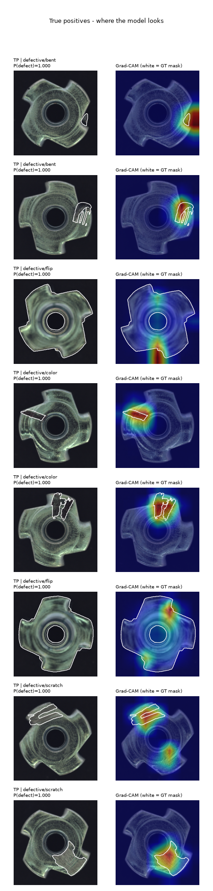
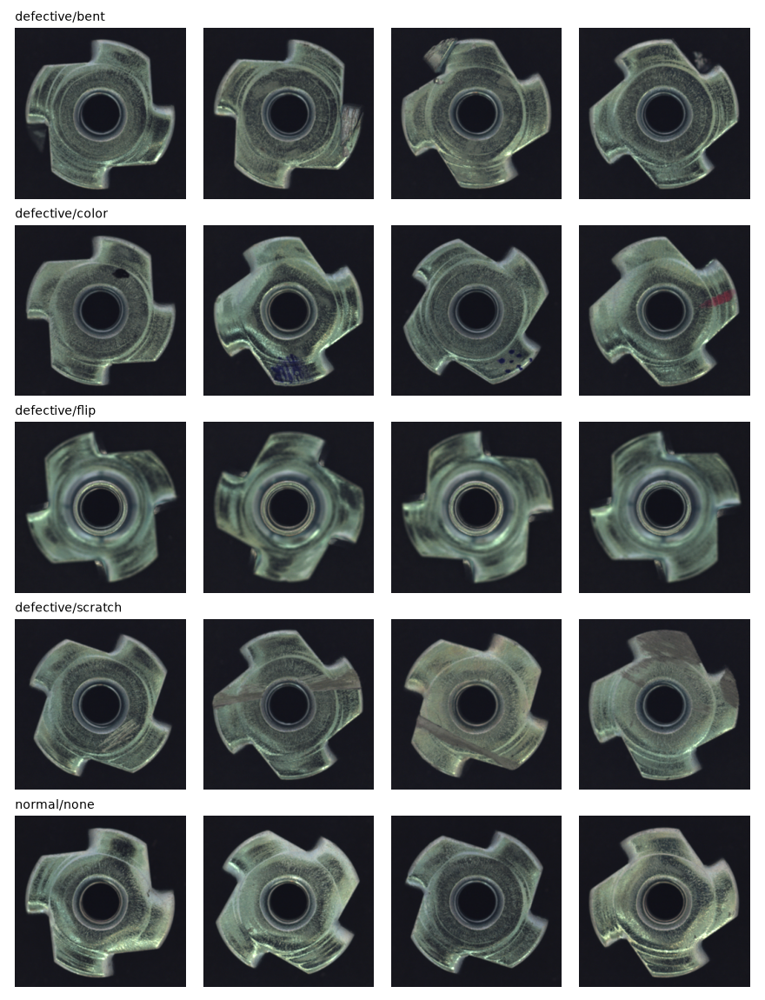
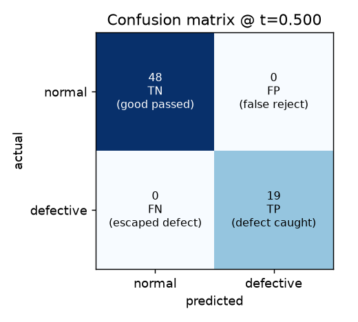
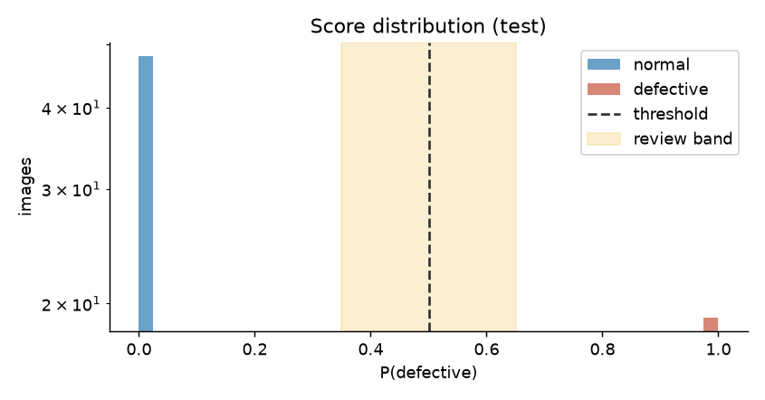
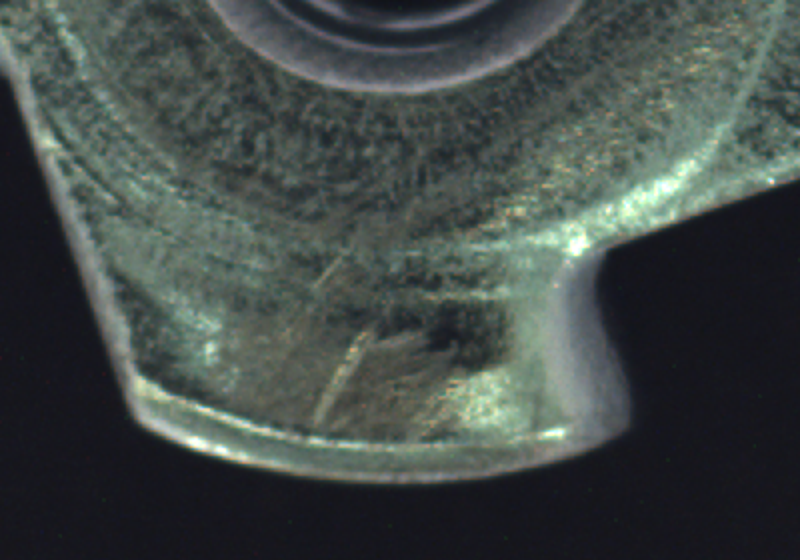
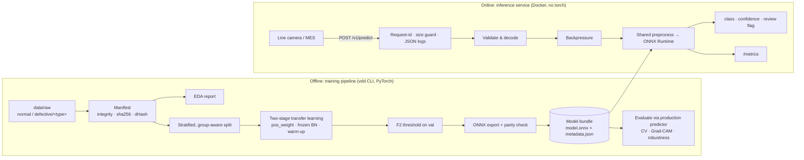

# Visual Defect Detection

A production-oriented computer vision system that classifies product images from a manufacturing
line as **normal** or **defective**. It covers dataset analysis, a leakage-safe split, transfer
learning with a backbone comparison, evaluation with honest uncertainty and error analysis, an ONNX
model served by a hardened FastAPI service, and Docker/Kubernetes packaging.

| | |
|---|---|
| **Production model** | MobileNetV3-Large (ImageNet-pretrained, fine-tuned), exported to ONNX (16.8 MB) |
| **Held-out test (67 images)** | 19/19 defects caught, 48/48 good parts passed; exact 95% CI: recall ≥ 0.82, specificity ≥ 0.93 |
| **5-fold cross-validation (all 335 images)** | recall **0.978** (91/93), specificity **0.996** (241/242), precision 0.989, F1 0.984 |
| **CPU latency** | 5.1 ms model inference (p50, batch 1); end-to-end API p50 **28 ms** incl. PNG upload decode; **~40 req/s per 2-vCPU replica** |
| **Unseen defect types** | recall drops to ~0.58: the main limitation, quantified in [§5](#unseen-defect-types-report) |
| **API** | `POST /v1/predict` → `predicted_class`, `confidence`, `defect_probability`, `review_recommended` |

<p align="center"></p>

---

## Contents

1. [Quick start](#1-quick-start)
2. [Dataset strategy](#2-dataset-strategy)
3. [Model approach](#3-model-approach)
4. [Evaluation results](#4-evaluation-results)
5. [Error analysis](#5-error-analysis)
6. [Accuracy / latency / size trade-offs](#6-accuracy--latency--size-trade-offs)
7. [Inference API](#7-inference-api)
8. [Deployment](#8-deployment)
9. [Architecture](#9-architecture)
10. [Known limitations & next steps](#10-known-limitations--next-steps)
11. [Project structure](#11-project-structure)

---

## 1. Quick start

### Run the API with the trained model (Docker)

The trained model bundle is committed in [`artifacts/model/`](artifacts/model/), so no training is needed.

```bash
docker build -t defect-detection-api .
docker run -p 8000:8000 defect-detection-api
# Swagger UI: http://localhost:8000/docs
curl -F "file=@examples/images/defective_scratch.png" http://localhost:8000/v1/predict
```

### Local development

Python 3.10+ (developed on 3.13, the container uses 3.12). CPU-only PyTorch is enough.

```bash
python -m venv .venv && source .venv/bin/activate        # Windows: .venv\Scripts\activate
pip install --extra-index-url https://download.pytorch.org/whl/cpu -r requirements/dev.txt
pip install --no-deps -e .

pytest                       # 53 tests: preprocessing, data/split, metrics, predictor, API
vdd serve --port 8000        # API from artifacts/model
```

### Reproduce training end to end

```bash
vdd download                 # public dataset -> data/raw/{normal,defective/<type>}  (~170 MB)
vdd prepare                  # manifest + integrity/duplicate checks + EDA report + split
vdd pipeline                 # train -> ONNX export (+parity check) -> evaluate -> error analysis -> benchmark
vdd promote                  # publish the run as artifacts/model + copy reports into reports/

# optional analyses
vdd compare                  # backbone accuracy / latency comparison      (~1.5 h on 8 CPU cores)
vdd cv                       # 5-fold cross-validation, out-of-fold errors (~40 min)
vdd robustness               # perturbation sweep (lighting, blur, noise, JPEG, rotation)
vdd holdout                  # unseen-defect-type generalisation           (~40 min)
```

Every command takes `--config configs/train.yaml` and `--set key=value` overrides, e.g.
`vdd pipeline --set train.backbone=efficientnet_b0 --set experiment_name=effb0`. Training a
MobileNetV3 takes **~8 min on a laptop CPU**; no GPU is required (one is used automatically if present).

### Using your own dataset

The pipeline is dataset-agnostic. Put images in this layout and run `vdd prepare && vdd pipeline`:

```
data/raw/normal/*.png|jpg|...
data/raw/defective/<defect_type>/*.png      # defect_type subfolder optional
data/masks/<defect_type>/<stem>_mask.png    # optional: enables Grad-CAM localisation scoring
```

---

## 2. Dataset strategy

### Which data

The assessment's dataset was not included with the brief, so I used a public stand-in that matches
the scenario: **MVTec AD `metal_nut`** (Bergmann et al., CVPR 2019; CC BY-NC-SA 4.0). It has real
industrial photos of one part type on a fixture, four realistic defect types, pixel-accurate defect
masks, and a small, imbalanced size. Swapping in the client's data needs no code changes (see above).

MVTec ships a train split with **only good parts** (it was built for unsupervised anomaly detection),
so I pooled all 335 images and made my own supervised split.

### Analysis ([`reports/eda/eda.md`](reports/eda/eda.md))

| Finding | Consequence |
|---|---|
| 242 normal / 93 defective (**27.8% defective, 2.6:1**) | Imbalance handling + recall-oriented metrics (accuracy alone would be misleading) |
| 4 defect types: bent 25, color 22, flip 23, scratch 23 | Stratify by **defect type**, not just class, so every type is in every split; report per-type recall |
| All 700×700 RGB, 0 corrupt files | Square resize is safe; the pipeline still letterboxes non-square input for other cameras |
| Smallest defect ≈ 0.7% of the image → **≈15 px at 224 px input** | 224 px input is enough for most defects, but thin scratches are near the resolution limit (confirmed in error analysis) |
| 0 exact / 0 near-duplicates | No leakage groups here; the machinery still matters for real line data (bursts of near-identical frames) |
| Defective images slightly less sharp (Laplacian var. 29 vs 37) | Possible shortcut; checked later with blur perturbation and Grad-CAM, and the model does **not** use it |



**A duplicate-detection bug worth mentioning.** My first near-duplicate check (64-bit dHash, Hamming
≤ 4, union-find) merged **299 of 335 images into one group**. On homogeneous product imagery, different
nuts in the same fixture are only 1–3 bits apart, and single-linkage chaining links everything. I
switched to a 256-bit hash with a threshold set from the measured distance distribution (the closest
genuinely different pair is 14 bits apart), and added a guard: the split now **refuses to run** if any
"duplicate group" holds more than 20% of the data, so this failure can't pass silently.

### Split ([`reports/eda/split.md`](reports/eda/split.md))

**65 / 15 / 20** train/val/test (217 / 51 / 67), stratified on `class × defect_type`, grouped on
duplicate clusters, deterministic (seed 42). Hard invariants are enforced before training starts
(no group or identical file across splits, both classes in every split).

Why a 20% test set: with 93 defects, a 15% test split leaves only ~3 images per defect type. Even at
20%, a single split is statistically thin, so I **also run 5-fold cross-validation** (section 4).

### Preprocessing and augmentation

* **Preprocessing** (shared by training, evaluation and the API, no train/serve skew):
  EXIF-orientation fix → RGB (handles grayscale, RGBA, palette, 16-bit) → letterbox to square → bilinear
  resize to 224 → ImageNet normalisation. A unit test checks it matches the torchvision reference to 1e-5.
* **Augmentation, chosen from the defect semantics:**

| Used | Why |
|---|---|
| Rotation ±180° | Parts sit at arbitrary angles on the line; label-preserving |
| Small translate (5%) / scale (±5%) | Fixture placement jitter |
| Brightness / contrast ±15% | Lighting drift between shifts and cameras |
| Mild Gaussian blur (p = 0.1) | Focus / motion variation |

| **Deliberately not used** | Why |
|---|---|
| Horizontal / vertical flip | The nut is **chiral**: a mirrored good nut looks exactly like the **"flip"** defect (part upside down). Flipping would inject label noise. A unit test enforces this. |
| Hue / saturation jitter | Would erase the **"color"** defect signal |
| Aggressive random crops | Could crop out a bent tab at the edge, turning a defective image into a "normal" one |

### Class imbalance

1. **`pos_weight = n_normal / n_defective` (≈ 2.6) in the BCE loss**, so a missed defect costs ~2.6× a
   false reject during training (a weighted sampler is available as an option).
2. **Model selection on average precision (PR-AUC)**, which stays informative under imbalance (unlike accuracy).
3. **Decision threshold tuned for F2** (recall weighted 2× precision) on validation, because an escaped
   defect reaching a customer costs more than re-inspecting a good part.
4. **Stratified splits per defect type**, so the minority types are present in every evaluation.

---

## 3. Model approach

### Why supervised transfer learning with MobileNetV3-Large

* **Transfer learning is the right tool at this data size.** 217 training images is far too few to
  train a CNN from scratch. ImageNet features (edges, textures, specular highlights) transfer well to
  metal-surface defects.
* **Supervised classification fits the task as stated**: labelled normal and defective examples
  exist, and the output must be a class plus a confidence. (The unsupervised alternative is discussed
  under limitations.)
* **MobileNetV3-Large** was chosen from a controlled 4-backbone comparison (section 6). It matched the
  best accuracy at the **lowest CPU latency and size**. It was designed for CPU/edge inference, which
  suits a line-side PC without a GPU.

### Training recipe ([`training/trainer.py`](src/defect_detection/training/trainer.py))

| Step | Detail | Reason |
|---|---|---|
| Stage 1: head warm-up (3 epochs) | Backbone frozen, new head only, LR 1e-3 | A random head's large gradients would otherwise damage pretrained features |
| Stage 2: full fine-tune (≤30 epochs) | Backbone LR 1e-4, head 1e-3 (discriminative), AdamW, wd 1e-4 | Adapt features to metal texture while staying close to pretrained weights |
| LR schedule | 2-epoch linear warm-up → cosine decay (per step) | See debugging note below |
| **Frozen BatchNorm statistics** | Running mean/var kept from ImageNet; affine params still train | See debugging note below |
| Early stopping | On val AP (tie-break val loss), patience 8 | Val AP saturates at 1.0 quickly on this data |
| Grad clipping, fixed seeds | Max norm 5; seed 42 | Stability, reproducibility |

**Two training bugs I found and fixed** (the training curves made them visible):

1. *Validation collapsed as soon as fine-tuning started* (val recall@0.5: 1.0 → 0.21). torchvision's
   MobileNetV3 uses BatchNorm momentum 0.01. In train mode the network normalised with batch
   statistics of dark-background metal nuts, while at eval time it used running statistics that had
   barely moved from ImageNet. That is a train/eval mismatch. **Fix: freeze BN statistics during
   fine-tuning** (standard for small datasets with batch 16).
2. *A loss spike on the first fine-tune step* (0.45 → 1.33): Adam's first updates are roughly LR-sized
   for every weight. **Fix: linear LR warm-up.** After both fixes training is smooth and val loss falls
   to ~1e-5 ([curves](reports/training_curves.png)).

### Export

The best checkpoint is wrapped as `image → sigmoid → P(defective)` and exported to **ONNX (opset 17)**
with a dynamic batch axis. Export **fails** unless ONNX Runtime matches PyTorch on real validation
images (max |Δp| measured: 2e-6). The bundle holds `model.onnx` and `metadata.json` (version,
preprocessing, threshold, review margin, sha256 of the model file).

---

## 4. Evaluation results

All test numbers come from running the **exported ONNX bundle through the production `DefectPredictor`**,
the same code path the API uses, so the numbers describe the deployed artifact.

### Held-out test split (67 images: 19 defective, 48 normal), [`reports/eval/report.md`](reports/eval/report.md)

| Metric | Value | 95% exact binomial CI |
|---|---|---|
| Recall (defect catch rate) | **1.000** (19/19) | [0.824, 1.000] |
| Specificity (good-part pass rate) | **1.000** (48/48) | [0.926, 1.000] |
| Precision | **1.000** | [0.824, 1.000] |
| F1 / PR-AUC / ROC-AUC | 1.000 / 1.000 / 1.000 | |

 

**How to read a perfect score.** 0 errors on 67 images is **not** evidence of a perfect model: the
exact binomial interval still allows recall as low as 0.82. (A percentile bootstrap gives a misleading
[1.0, 1.0] here, so the report shows both and explains why.) That is why I also ran cross-validation.

### 5-fold cross-validation (every image scored out-of-fold), [`reports/cv/cv_report.md`](reports/cv/cv_report.md)

Each fold trains a fresh model (its own validation split for early stopping and the threshold),
exports it, and scores its held-out fifth with the ONNX bundle. Pooled over all 335 images:

| Metric | Value | 95% exact CI |
|---|---|---|
| Recall (defect catch rate) | **0.978** (91/93) | [0.924, 0.997] |
| Specificity (good-part pass rate) | **0.996** (241/242) | [0.977, 1.000] |
| Precision | **0.989** | [0.941, 1.000] |
| F1 | **0.984** | |
| Flagged for review (\|p − t\| < 0.15) | 0.6% of parts | |

| Fold | 0 | 1 | 2 | 3 | 4 | mean ± sd |
|---|---|---|---|---|---|---|
| Recall | 1.000 | 1.000 | 1.000 | 0.944 | 0.944 | 0.978 ± 0.030 |
| Specificity | 0.979 | 1.000 | 1.000 | 1.000 | 1.000 | 0.996 ± 0.009 |

Per defect type (out-of-fold): **bent 25/25, color 22/22, flip 23/23, scratch 21/23**.

**What CV changed: a threshold-selection weakness.** In the first CV run, three folds chose a
threshold of about **0.00–0.005** instead of about 0.5, which caused 5 false rejects. The cause: the
fine-tuned network outputs *saturated* probabilities, and with only ~14 defects in a validation split,
a single hard validation defect scored at p ≈ 0.001 made a near-zero threshold look "free" (no extra
validation false positives), while in production it lets marginal good parts through. **Fix:** bound the
threshold search to [0.05, 0.95] (`threshold.search_bounds`). Re-running the full CV with the fix: false
rejects **5 → 1**, recall unchanged (0.978 → 0.978). For transparency, this bound was chosen *after*
seeing the CV failure; the single held-out test split was unaffected (its threshold was already 0.50).

---

## 5. Error analysis

Full reports: [test split](reports/error_analysis/error_analysis.md) · [cross-validation](reports/cv/cv_report.md) ·
[robustness](reports/robustness/perturbations.md) · [unseen defects](reports/holdout/unseen_defect_holdout.md)

### Does the model look at the defect? Grad-CAM vs ground-truth masks

For each detected defect I check whether the Grad-CAM peak falls inside the (slightly dilated)
ground-truth mask (a "pointing game").

| | n | CAM peak inside defect mask | CAM energy inside mask | median defect area |
|---|---|---|---|---|
| All true positives | 19 | **84%** | 52% | 4.5% of image |
| bent | 5 | 60% | | 1.4% |
| color | 4 | 100% | | 2.7% |
| flip | 5 | 80% | | 48.7% |
| scratch | 5 | 100% | | 5.9% |

52% of the attribution falls inside regions covering ~4.5% of the image, more than 10× chance. The
model keys on the defect itself, not on a background, position or lighting shortcut. **Bent** is the
weakest: the smallest defects (median 1.4% of the image, a deformed tab tip) and the most diffuse attention.

### False negatives and false positives (out-of-fold, cross-validation)

The test split has no errors, so the failure analysis uses the 3 out-of-fold errors from cross-validation
(of 335 images), plus the hardest correctly classified cases ([gallery](reports/cv/oof_hardest_gradcam.png)).


| Error | P(defective) | What happened | Implication |
|---|---|---|---|
| **FN** scratch_000 | 0.000 | The **smallest scratch in the dataset** (1.9% of the image, a thin, low-contrast line near a tab). Grad-CAM points at background: at 224 px the scratch is ~1–2 px wide and effectively disappears. | Resolution limit, the model's main blind spot. Fix: higher input resolution or tiling. |
| **FN** scratch_022 | 0.429 | Grad-CAM is **on** the scratch; the model saw it but stayed just under the threshold. | Inside the review band, so `review_recommended=true` routes it to a human. With review, escapes drop to **1 of 93**. |
| **FP** good_187 | 1.000 | Labelled *good*, but the lower tab shows **visible scratch-like marks** exactly where Grad-CAM points (crop below). | Likely label noise or a borderline cosmetic mark: send to a domain expert, not a model fix. |



**Patterns:**
* **Scratch is the weakest type** (21/23): thin, low-contrast, high-aspect-ratio defects are the first
  casualty of downscaling 700 → 224 px. Both misses are scratches; the confident miss is the smallest one.
* **False positives are rare and explainable:** 1 of 242 good parts, and that one plausibly has a real mark.
* **Errors cluster where the model is unsure**, so the review band is useful: it flags 0.6% of
  parts and catches the borderline miss.
* **The model is over-confident** (most scores are < 0.001 or > 0.999). That is fine for ranking, but
  it makes the probabilities poor estimates of risk and made the threshold fragile (see the CV note
  above). Temperature scaling on a larger calibration set is the fix.

### Robustness to camera / lighting drift ([report](reports/robustness/perturbations.md))

Test set, fixed threshold, inference only:

| Perturbation | Recall | False-reject rate | ROC-AUC |
|---|---|---|---|
| clean | 1.000 | 0.000 | 1.000 |
| brightness −30% | **0.947** (1 bent missed) | 0.000 | 1.000 |
| brightness +30%, contrast −30% | 1.000 | 0.000 | 1.000 |
| Gaussian blur r=2 / r=4 | 1.000 | 0.000 | 1.000 |
| sensor noise σ=10 / σ=25 | 1.000 | 0.000 | 1.000 |
| JPEG quality 30 | 1.000 | 0.000 | 1.000 |
| rotation 45°, 4× down-/up-scale | 1.000 | 0.000 | 1.000 |

* **Lighting is the sensitive axis.** At −30% brightness (twice the ±15% training augmentation) one
  bent nut drops below threshold, though ranking stays perfect (AUC 1.0), so only the operating point
  shifts. Operationally: control line lighting and watch the score-distribution metric for drift.
* **Blur does not create false rejects.** This answers the EDA's sharpness-shortcut concern: if the
  model had learned "blurry ⇒ defective", blurring good parts would have raised the false-reject rate.

### Unseen defect types ([report](reports/holdout/unseen_defect_holdout.md))

A supervised classifier learns *the defects it was shown*. To measure what happens when a new failure
mode appears on the line, I retrained four times, each time **removing one defect type entirely from
train and val**, then scored all images of that type:

| Defect type never seen in training | Recall on it | Mean P(defective) | AUC vs normal | Recall on seen types | False-reject rate |
|---|---|---|---|---|---|
| flip | 0.913 | 0.91 | 1.000 | 0.929 | 0.000 |
| bent | 0.600 | 0.64 | 0.982 | 1.000 | 0.000 |
| color | 0.409 | 0.39 | 0.890 | 1.000 | 0.000 |
| scratch | 0.391 | 0.37 | 0.964 | 1.000 | 0.000 |
| **mean** | **0.578** | | | | |

* **This is the system's most important limitation.** Recall drops from ~0.98 on known defect types to
  **~0.58 on an unseen type**, as low as 0.39 for scratches.
* **Flip generalises** (it changes the whole part's appearance); **color and scratch do not**: a blue
  paint spot or a fine line is not like anything else in training.
* **The signal is there, below the threshold.** AUC vs normal stays at 0.89–1.00, so unseen defects
  still score higher than good parts. That is why an anomaly-detection score plus the review band is the
  right complement (section 10), rather than a bigger classifier.

---

## 6. Accuracy / latency / size trade-offs

Same split, augmentation, imbalance handling and threshold strategy; only the backbone changes.
Latency: ONNX Runtime, CPU (8 cores), batch 1, model only, idle machine. ([table](reports/model_comparison.md))

| Backbone | Params | ONNX size | Test recall | Test FN | Test AP | ONNX p50 | PyTorch p50 |
|---|---|---|---|---|---|---|---|
| **MobileNetV3-Large** ✅ | 4.2 M | 16.8 MB | **1.000** | 0 | 1.000 | **5.1 ms** | 23.8 ms |
| EfficientNet-B0 | 4.0 M | 16.0 MB | 1.000 | 0 | 1.000 | 11.1 ms | 27.0 ms |
| ResNet-18 | 11.2 M | 44.7 MB | 0.947 | 1 | 1.000 | 20.0 ms | 33.9 ms |
| ResNet-50 | 23.5 M | 94.0 MB | 0.947 | 1 | 1.000 | 44.0 ms | 88.4 ms |


* **Accuracy is not the deciding factor here:** every backbone ranks the test set perfectly (AP 1.0).
  The larger ResNets each let one defect fall below their validation-tuned threshold, which fits more
  capacity overfitting ~200 training images. (ResNet-18's miss was a scratch at P=0.41, inside the review band.)
* **Latency and footprint decide it.** MobileNetV3 is 2× faster than EfficientNet-B0 (SiLU and
  squeeze-excite cost more on CPU), 4× faster than ResNet-18 and 9× faster than ResNet-50, and 2.7× / 5.6×
  smaller than those ResNets.
* **ONNX Runtime vs PyTorch eager: ~4.7× faster** for the same weights (graph fusion, no Python overhead),
  and it keeps PyTorch out of the serving image entirely.
* **End-to-end budget per request** (measured in the container): decode the uploaded 500 KB PNG ≈ 20–30 ms,
  resize + normalise ≈ 5 ms, model ≈ 6 ms. **The model is now the smallest cost.** The next levers are
  the input format (JPEG or a pre-cropped region from the camera) and faster image I/O (OpenCV /
  Pillow-SIMD), not a smaller network. Model-only batched throughput is ~230 images/s on 8 cores.
* **If accuracy had to go up** (e.g. thin scratches), the cheapest lever is **input resolution**
  (320–448 px roughly 2–4× compute) rather than a bigger backbone. See limitations.

---

## 7. Inference API

FastAPI service (`src/defect_detection/serving/`), interactive docs at `/docs`.

| Method | Path | Purpose |
|---|---|---|
| `POST` | `/v1/predict` | One image (multipart `file`) → prediction |
| `POST` | `/v1/predict/batch` | Up to 16 images (`files`) in one forward pass; per-item errors |
| `GET` | `/v1/model` | Model version, threshold, preprocessing |
| `GET` | `/health/live`, `/health/ready` | Liveness / readiness probes |
| `GET` | `/metrics` | Prometheus metrics |

```bash
curl -F "file=@examples/images/defective_bent.png" http://localhost:8000/v1/predict
```

```json
{
  "request_id": "eee4c6b70916444c940864e339fe60e1",
  "model_version": "mobilenet_v3_large-20261008061215",
  "filename": "defective_bent.png",
  "prediction": {
    "predicted_class": "defective",
    "confidence": 0.999012,
    "defect_probability": 0.999012,
    "threshold": 0.5000728326995159,
    "review_recommended": false
  },
  "timing": {"decode_ms": 29.885, "preprocess_ms": 5.451, "inference_ms": 6.22, "total_ms": 42.229}
}
```

* `confidence` = the model's probability of the **predicted** class (`p` if defective, `1 − p` if normal).
* `review_recommended` = the score is within ±0.15 of the threshold, so the part goes to **manual
  inspection** instead of a silent hard decision. (ResNet-18's one missed scratch scored 0.41 and
  would have been flagged.)

### Example predictions

From the running Docker container ([`examples/example_predictions.json`](examples/example_predictions.json),
via `python scripts/demo_client.py`). All images are from the held-out test split.

| Image | Ground truth | Predicted | Confidence | P(defective) | Review |
|---|---|---|---|---|---|
| [defective_bent.png](examples/images/defective_bent.png) | bent | **defective** | 0.999 | 0.999 | no |
| [defective_color.png](examples/images/defective_color.png) | color | **defective** | 1.000 | 1.000 | no |
| [defective_flip.png](examples/images/defective_flip.png) | flip | **defective** | 1.000 | 1.000 | no |
| [defective_scratch.png](examples/images/defective_scratch.png) | scratch | **defective** | 1.000 | 1.000 | no |
| [normal_example.png](examples/images/normal_example.png) | good | **normal** | 1.000 | 0.000005 | no |
| [normal_example_2.png](examples/images/normal_example_2.png) | good | **normal** | 1.000 | 0.000004 | no |
| `corrupt.png` (12 bytes of text) | – | `422 invalid_image` | | | |

**Where the time goes** (in-container, per request): decode ≈ 20–30 ms for a 500 KB lossless
700×700 PNG, preprocess ≈ 5 ms, inference ≈ 6 ms. **Decoding the upload costs more than the
model.** On a real line, sending JPEG or a pre-cropped region would cut end-to-end latency more than
any model change.

### Validation, errors and logging

| Input problem | Response |
|---|---|
| Not an image / corrupt / truncated | `422 invalid_image` |
| Wrong content type | `415 unsupported_media_type` |
| File > 10 MB, batch > 16, oversized body | `413` (oversized bodies rejected from `Content-Length` before reading) |
| Image < 32 px side, or > 40 MP (decompression bomb) | `422 invalid_image` |
| Missing field | `422 invalid_request` |
| Wrong / missing `X-API-Key` (when `VDD_API_KEY` is set) | `401` |
| Too many in-flight inferences | `503 overloaded` + `Retry-After` (backpressure) |
| Unexpected exception | `500 internal_error` (details only in logs) |

Every error has the same JSON shape (`{"error": {"code", "message"}, "request_id"}`), and every response
carries `X-Request-ID`. Logs are JSON lines with the request id; the client sees a generic message and
the root cause goes to the log. The service **fails fast at startup** if the model bundle is missing or its
sha256 doesn't match `metadata.json`.

**Prometheus metrics:** request count and latency per route, inference latency, predictions per class,
review-flag count, rejected inputs by reason, in-flight inferences, the loaded model version, and a
**histogram of `P(defective)`**, the cheapest label-free drift signal (if mid-range scores become
more common, the input distribution has shifted).

Configuration is via environment variables (`VDD_*`, see [`serving/settings.py`](src/defect_detection/serving/settings.py)),
e.g. `VDD_THRESHOLD_OVERRIDE` sets a stricter operating point per line without re-exporting.

**Offline batch scoring** (no server): `vdd predict path/to/folder --output predictions.csv`.

---

## 8. Deployment

* **[`Dockerfile`](Dockerfile)** (multi-stage, `python:3.12-slim`, **no PyTorch**, 509 MB): onnxruntime +
  FastAPI, non-root user, healthcheck, model baked in so one image is one code + model version.
  Mount a bundle over `/app/model` to swap models without rebuilding.
* **[`docker-compose.yml`](docker-compose.yml)**: API with CPU/memory limits; `--profile monitoring` adds Prometheus.
* **[`deploy/k8s.yaml`](deploy/k8s.yaml)**: Deployment (readiness/liveness probes, non-root, read-only
  root filesystem), Service, and an HPA on CPU.
* **[`Dockerfile.train`](Dockerfile.train)**: reproducible CPU training environment.
* **[CI](.github/workflows/ci.yml)**: lint + 53 tests, then builds the image and smoke-tests a real prediction.

**Scaling model:** the service is stateless, with one worker per container and capped ONNX Runtime
threads (`VDD_ORT_INTRA_OP_THREADS=2`). It scales **horizontally** with replicas, which keeps per-pod
latency predictable and Prometheus metrics consistent. CPU-heavy work runs in a threadpool so health
checks never block. A bounded semaphore sheds load with 503s rather than letting latency grow without bound.

**Load test** (`scripts/load_test.py`, real HTTP against the container limited to **2 vCPUs** like the
k8s pod limit, 300 requests of full 500 KB PNGs per run, 0 errors):

| Concurrent clients | Throughput | p50 latency | p95 latency |
|---|---|---|---|
| 1 | 25.9 req/s | 27.8 ms | 70.1 ms |
| 4 | **42.7 req/s** | 95.2 ms | 121.5 ms |
| 8 | 38.3 req/s | 201.3 ms | 286.2 ms |

One 2-vCPU replica saturates at **~40 images/s**. Beyond that, extra concurrency only adds queueing
latency, so capacity comes from **replicas** (the HPA), not from more in-process concurrency. A line
inspecting 10 parts/s needs one replica with headroom; 100 parts/s needs about 3 replicas, or JPEG uploads
to cut the PNG-decode cost that dominates each request.

**Model lifecycle:** `vdd pipeline` → review `reports/` → `vdd promote` (copies the bundle) → build
image tagged with `model_version` → roll out. The threshold, preprocessing and checksum travel inside
the bundle, so the code never hard-codes model assumptions.

---

## 9. Architecture



More detail (design decisions, request sequence diagram): [`docs/architecture.md`](docs/architecture.md).

---

## 10. Known limitations & next steps

| Limitation | Evidence | What I would do next |
|---|---|---|
| **Public stand-in data, one part type** | The brief's dataset wasn't provided | Run `vdd prepare && vdd pipeline` on the client's images; expect to re-tune augmentation (e.g. flips are fine for non-chiral parts) |
| **Small evaluation sets** | 67 test images: 0 errors still means recall ≥ 0.82 at 95% | Collect more labelled defects; keep reporting exact CIs and CV, never just a point estimate |
| **Only known defect types are reliable** | Unseen-type hold-out: recall ~0.98 → **~0.58** (scratch 0.39, color 0.41) | Add an **unsupervised anomaly detector** (e.g. PatchCore, trained on good parts only) as a second signal; flag "anomalous but not a known defect" for review |
| **Thin / tiny defects at 224 px** | Both CV misses are scratches; the confident miss is the smallest scratch in the dataset | Train at 320–448 px or tile the image into crops (2–4× compute, still cheap with MobileNetV3) |
| **Over-confident probabilities** | Most scores are < 0.001 or > 0.999; caused the threshold-collapse bug | Temperature scaling / isotonic calibration on a dedicated calibration set, so `confidence` means something and the review band stays useful |
| **Threshold tuned on ~14 validation defects** | Fold-to-fold threshold collapse before the bound was added | Tune on pooled out-of-fold predictions or a larger calibration set; agree the recall target with the client (cost of an escape vs a re-inspection) |
| **Sensitive to large lighting changes** | −30% brightness: one bent nut missed (ranking unchanged) | Control lighting; stronger brightness augmentation; alert on the `vdd_defect_probability` histogram drifting |
| **Possible label noise** | "Good" image 187 shows scratch-like marks and is scored 1.0 | Domain-expert relabel pass on confident disagreements (cheap, high value) |
| **No production feedback loop yet** | n/a | Log flagged and overridden decisions → periodic relabel → retrain → shadow-deploy the new bundle next to the old one before promotion |
| **CPU only, one model per process** | ~40 req/s per 2-vCPU replica end-to-end (~230 img/s model-only, batched, 8 cores) | Enough for typical line rates; for more, use ONNX INT8 quantisation (needs re-validating accuracy) or a GPU execution provider, both without code changes in the API |

**Choices I would revisit with more time:** k-fold *ensembles* (averaging the 5 CV models would
likely help with the borderline scratch), a segmentation head that uses the masks (localises defects for operators),
and a test-time-augmentation pass (rotations) for borderline scores only.

---

## 11. Project structure

```
configs/train.yaml                 experiment config (every run snapshots its resolved config)
src/defect_detection/
  preprocessing.py                 shared, framework-free decode + preprocess (train = eval = serve)
  config.py                        typed config (pydantic), strict: unknown keys are errors
  cli.py                           `vdd` command line
  data/        download · manifest (integrity, hashing, duplicate groups) · analyze (EDA) · split
  training/    dataset + augmentation · model factory · two-stage trainer
  export.py                        ONNX export + parity verification + bundle metadata
  inference/predictor.py           ONNX Runtime predictor (no torch)
  evaluation/  metrics · evaluate · error_analysis (Grad-CAM) · cross_validation · robustness · benchmark · compare
  serving/     FastAPI app · settings · schemas
tests/                             53 tests (tiny synthetic ONNX model, so tests don't need the trained weights)
artifacts/model/                   promoted production bundle (model.onnx + metadata.json)
reports/                           EDA, evaluation, error analysis, CV, robustness, comparison
deploy/                            Kubernetes + Prometheus config
scripts/                           demo client, load test
docs/                              architecture, video walkthrough script
```
