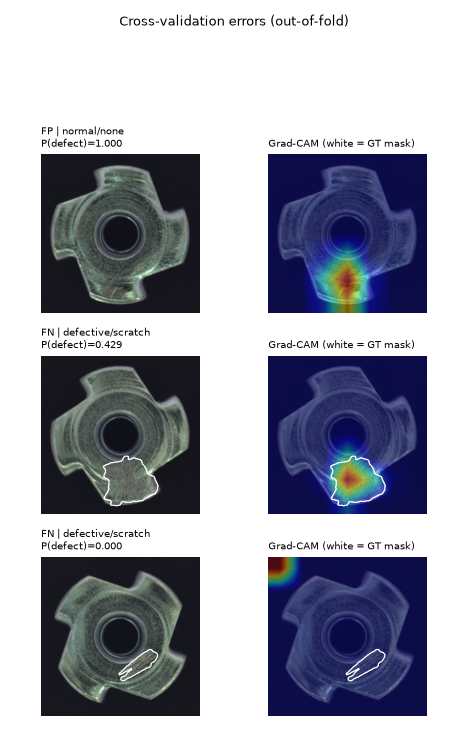
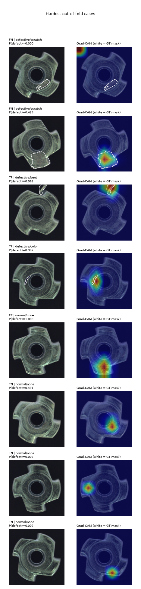

# 5-fold cross-validation (out-of-fold, 335 images)

Every image is scored by a model that never saw it (its fold's exported ONNX bundle, threshold tuned on that fold's validation split).

| pooled OOF metric | value | 95% exact CI |
|---|---|---|
| Recall (defect catch rate) | 0.978 (91/93) | [0.924, 0.997] |
| Specificity (good pass rate) | 0.996 (241/242) | [0.977, 1.000] |
| Precision | 0.989 | [0.941, 1.000] |
| F1 | 0.984 | |
| ROC-AUC / AP (pooled, indicative) | 0.987 / 0.979 | |

## Per fold

|   fold |      n |   threshold |   best_epoch |   precision |   recall |   specificity |    f1 |     tp |    fp |    fn |   roc_auc |   average_precision |
|-------:|-------:|------------:|-------------:|------------:|---------:|--------------:|------:|-------:|------:|------:|----------:|--------------------:|
|  0.000 | 67.000 |       0.500 |       18.000 |       0.950 |    1.000 |         0.979 | 0.974 | 19.000 | 1.000 | 0.000 |     0.988 |               0.945 |
|  1.000 | 67.000 |       0.500 |       13.000 |       1.000 |    1.000 |         1.000 | 1.000 | 19.000 | 0.000 | 0.000 |     1.000 |               1.000 |
|  2.000 | 67.000 |       0.500 |        9.000 |       1.000 |    1.000 |         1.000 | 1.000 | 19.000 | 0.000 | 0.000 |     1.000 |               1.000 |
|  3.000 | 67.000 |       0.500 |       22.000 |       1.000 |    0.944 |         1.000 | 0.971 | 17.000 | 0.000 | 1.000 |     1.000 |               1.000 |
|  4.000 | 67.000 |       0.500 |       18.000 |       1.000 |    0.944 |         1.000 | 0.971 | 17.000 | 0.000 | 1.000 |     0.961 |               0.959 |

## Per defect type (OOF)

| defect_type   |      n |   detected |   min_p |   recall |
|:--------------|-------:|-----------:|--------:|---------:|
| bent          | 25.000 |     25.000 |   0.962 |    1.000 |
| color         | 22.000 |     22.000 |   0.987 |    1.000 |
| flip          | 23.000 |     23.000 |   1.000 |    1.000 |
| scratch       | 23.000 |     21.000 |   0.000 |    0.913 |

## Out-of-fold errors

| image_id                             |   fold | class_name   | defect_type   |   defect_probability |   threshold | outcome   |
|:-------------------------------------|-------:|:-------------|:--------------|---------------------:|------------:|:----------|
| normal__train_good_187               |      0 | normal       | none          |               1.0000 |      0.5000 | FP        |
| defective__scratch__test_scratch_022 |      3 | defective    | scratch       |               0.4291 |      0.5000 | FN        |
| defective__scratch__test_scratch_000 |      4 | defective    | scratch       |               0.0000 |      0.5000 | FN        |

