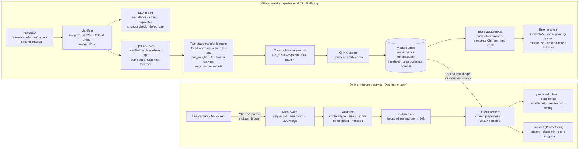
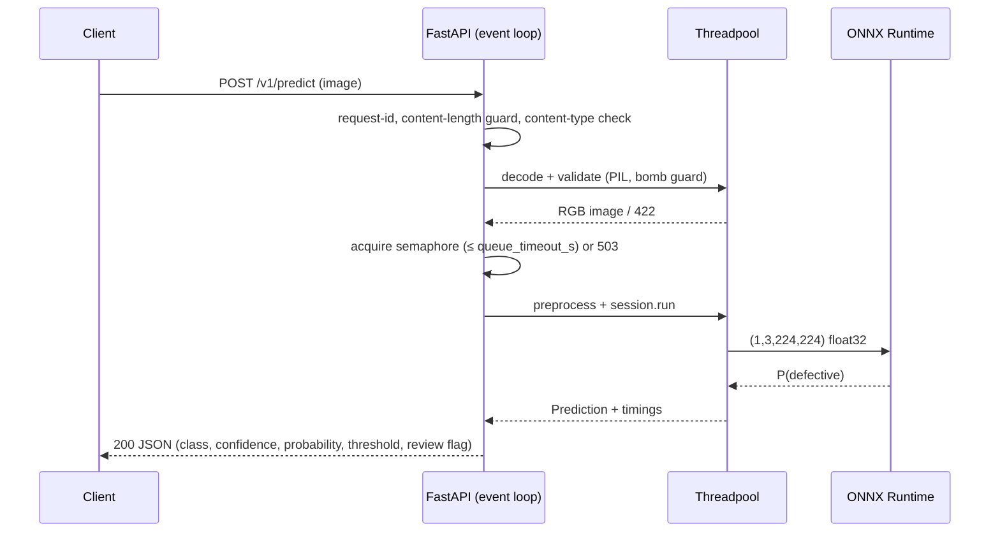

# Architecture

## End-to-end system

## Key design decisions

| Concern | Decision | Why |
|---|---|---|
| Train/serve skew | One framework-free `preprocess()` used by training, evaluation and API | Resize / normalisation can never diverge between offline metrics and production |
| Deployed artifact = evaluated artifact | Test metrics are computed by running the **exported ONNX bundle** through `DefectPredictor` | Numbers in the README describe what is actually served |
| Operating point | Threshold stored in `metadata.json`, overridable via `VDD_THRESHOLD_OVERRIDE` | Changing strictness for a line is a config change, versioned with the model |
| Model integrity | sha256 of `model.onnx` checked at startup; service fails fast | A corrupted or mismatched bundle never serves traffic |
| Image size | onnxruntime + FastAPI only (no torch) | ~10x smaller image, faster cold start, smaller attack surface |
| Scalability | Stateless process, 1 worker/container, ORT threads capped, horizontal replicas (HPA on CPU) | Predictable per-pod latency; linear scale-out; consistent metrics |
| Overload | Bounded in-flight inferences, 503 + `Retry-After` after `queue_timeout_s` | Fails fast instead of unbounded latency growth |
| Uncertain cases | `review_recommended` when \|p − t\| < margin | Human-in-the-loop for borderline parts instead of a silent hard decision |
| Observability | JSON logs with request id; Prometheus counters/histograms incl. score distribution | Score-distribution shift is an early, label-free drift signal |

## Request lifecycle

