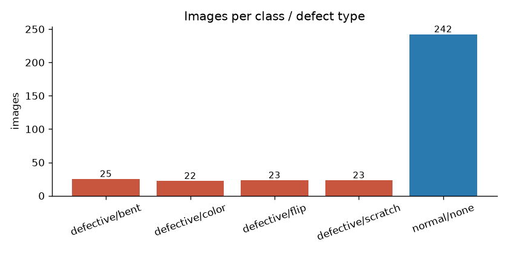
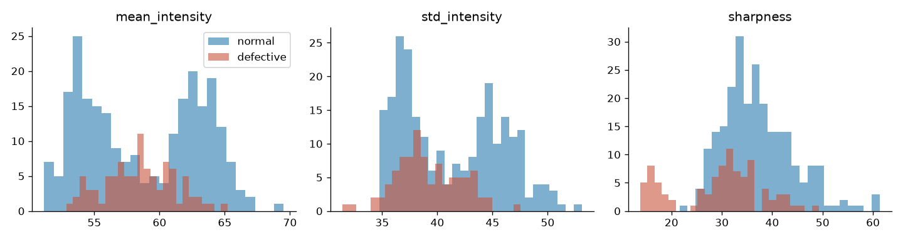
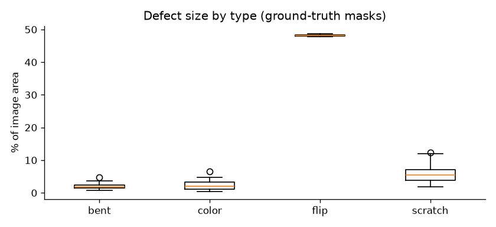

# Dataset analysis

- Valid images: **335** (invalid / corrupt: 0)
- Normal: **242**, Defective: **93** (27.8% defective, ratio 2.602:1)
- Image sizes: {'700x700': 335}; colour modes: {'RGB': 335}
- Exact duplicates: 0; near-duplicate groups (>1 image): 0 (largest 1)
- Smallest annotated defect ~ **14.8 px** square at 224px model input

## Counts per class / defect type

| class_name   | defect_type   |   count |
|:-------------|:--------------|--------:|
| defective    | bent          |      25 |
| defective    | color         |      22 |
| defective    | flip          |      23 |
| defective    | scratch       |      23 |
| normal       | none          |     242 |

## Per-class image statistics (shortcut check)

If these differ strongly between classes, a model can 'cheat' on global brightness or
focus instead of learning the defect.

| class_name   |   ('mean_intensity', 'mean') |   ('mean_intensity', 'std') |   ('std_intensity', 'mean') |   ('std_intensity', 'std') |   ('sharpness', 'mean') |   ('sharpness', 'std') |   ('mean_r', 'mean') |   ('mean_r', 'std') |   ('mean_g', 'mean') |   ('mean_g', 'std') |   ('mean_b', 'mean') |   ('mean_b', 'std') |
|:-------------|-----------------------------:|----------------------------:|----------------------------:|---------------------------:|------------------------:|-----------------------:|---------------------:|--------------------:|---------------------:|--------------------:|---------------------:|--------------------:|
| defective    |                        58.43 |                        2.67 |                       39.19 |                       2.93 |                   29.46 |                   8.67 |                54.82 |                2.87 |                60.09 |                3.09 |                60.38 |                2.19 |
| normal       |                        58.73 |                        4.53 |                       41.31 |                       4.59 |                   37.15 |                   7    |                54.8  |                4.61 |                60.49 |                5.06 |                60.91 |                3.98 |

## Defect area (fraction of image covered by ground-truth mask)

| defect_type   |   count |    min |    50% |    max |
|:--------------|--------:|-------:|-------:|-------:|
| bent          |      25 | 0.0071 | 0.0187 | 0.047  |
| color         |      22 | 0.0044 | 0.0209 | 0.0657 |
| flip          |      23 | 0.4785 | 0.4817 | 0.4872 |
| scratch       |      23 | 0.019  | 0.0554 | 0.123  |

