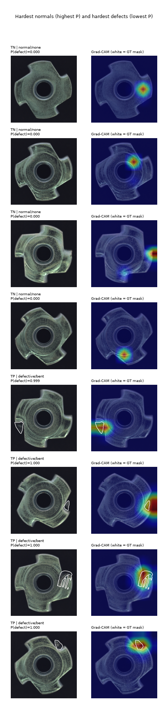

# Error analysis (test set)

Threshold 0.500. False positives: **0**, false negatives: **0**, cases within ±0.15 of threshold: 0.

## False negatives (escaped defects)

_none_

## False positives (false rejects)

_none_

## Hardest cases (even if correctly classified)

Lowest-scoring defects:

| image_id                       | defect_type   |   defect_probability |   margin |   mask_area_frac | cam_peak_in_mask   |
|:-------------------------------|:--------------|---------------------:|---------:|-----------------:|:-------------------|
| defective__bent__test_bent_006 | bent          |                0.999 |   0.4989 |           0.0139 | False              |
| defective__bent__test_bent_007 | bent          |                1     |   0.4999 |           0.0071 | False              |
| defective__bent__test_bent_010 | bent          |                1     |   0.4999 |           0.0289 | True               |
| defective__bent__test_bent_014 | bent          |                1     |   0.4999 |           0.0107 | True               |

Highest-scoring normals:

| image_id               | defect_type   |   defect_probability |   margin |   mask_area_frac |   cam_peak_in_mask |
|:-----------------------|:--------------|---------------------:|---------:|-----------------:|-------------------:|
| normal__train_good_022 | none          |               0.0001 |      0.5 |              nan |                nan |
| normal__train_good_200 | none          |               0      |      0.5 |              nan |                nan |
| normal__train_good_058 | none          |               0      |      0.5 |              nan |                nan |
| normal__train_good_010 | none          |               0      |      0.5 |              nan |                nan |

## Localisation sanity check (Grad-CAM vs ground-truth mask)

`cam_peak_in_mask` = share of images whose Grad-CAM maximum lies inside the defect mask (dilated 6px at 320px display). High values on TPs mean the model keys on the defect, not on a shortcut.

| outcome   |   n |   cam_peak_in_mask |   cam_energy_in_mask |   median_defect_area_pct |
|:----------|----:|-------------------:|---------------------:|-------------------------:|
| TP        |  19 |           0.842105 |                0.525 |                     4.49 |

| defect_type   |   n |   recall |   cam_peak_in_mask |   median_defect_area_pct |   min_p |
|:--------------|----:|---------:|-------------------:|-------------------------:|--------:|
| bent          |   5 |        1 |                0.6 |                    1.39  |   0.999 |
| color         |   4 |        1 |                1   |                    2.658 |   1     |
| flip          |   5 |        1 |                0.8 |                   48.671 |   1     |
| scratch       |   5 |        1 |                1   |                    5.908 |   1     |

