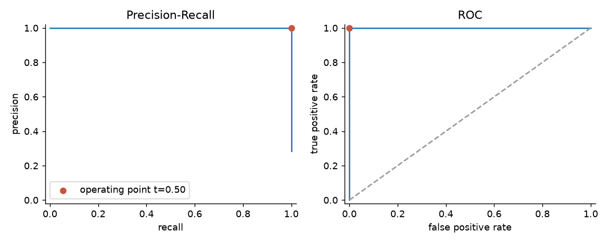
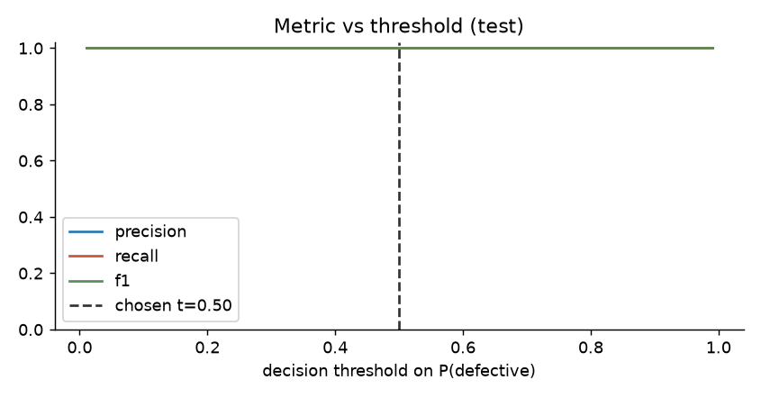

# Test evaluation - `mobilenet_v3_large-20261008061215`

Test set: 67 images (19 defective, 48 normal). Decision threshold **0.500** (tuned on validation).

| metric | value | 95% exact binomial CI | 95% bootstrap CI |
|---|---|---|---|
| Precision | 1.000 | [0.824, 1.000] | [1.000, 1.000] |
| Recall (defect catch rate) | 1.000 | [0.824, 1.000] | [1.000, 1.000] |
| Specificity (good pass rate) | 1.000 | [0.926, 1.000] | [1.000, 1.000] |
| F1 | 1.000 | | [1.000, 1.000] |
| Average precision (PR-AUC) | 1.000 | | [1.000, 1.000] |
| ROC-AUC | 1.000 | | [1.000, 1.000] |
| Balanced accuracy | 1.000 | | |
| Expected calibration error | 0.000 | | |
| Flagged for human review | 0.0% | | |

The bootstrap CI collapses to a point when there are no errors; the exact binomial CI is the honest bound for a test set this size.

Confusion @ threshold: TP=19 FP=0 TN=48 FN=0  
For reference @ 0.5: precision=1.000, recall=1.000, FP=0, FN=0

## Recall per defect type

| defect_type   |   n |   detected |   mean_p |   recall |
|:--------------|----:|-----------:|---------:|---------:|
| bent          |   5 |          5 |   0.9998 |        1 |
| color         |   4 |          4 |   1      |        1 |
| flip          |   5 |          5 |   1      |        1 |
| scratch       |   5 |          5 |   1      |        1 |

 

 
