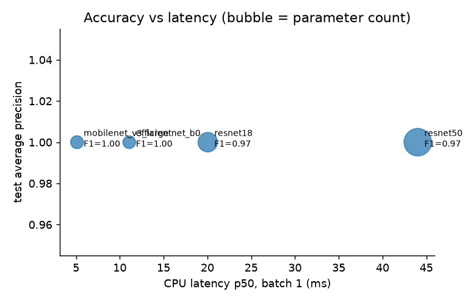

# Backbone comparison (same split / augmentation / threshold strategy)

| backbone           |   params_M |   onnx_MB |   val_AP |   test_AP |   test_ROC_AUC |   threshold |   precision |   recall |    f1 |   FP |   FN |   onnx_p50_ms |   onnx_p95_ms |   torch_p50_ms |   best_epoch |   train_min |
|:-------------------|-----------:|----------:|---------:|----------:|---------------:|------------:|------------:|---------:|------:|-----:|-----:|--------------:|--------------:|---------------:|-------------:|------------:|
| mobilenet_v3_large |      4.203 |    16.810 |    1.000 |     1.000 |          1.000 |       0.500 |       1.000 |    1.000 | 1.000 |    0 |    0 |         5.116 |        13.311 |         23.810 |           18 |       8.460 |
| efficientnet_b0    |      4.009 |    16.030 |    1.000 |     1.000 |          1.000 |       0.500 |       1.000 |    1.000 | 1.000 |    0 |    0 |        11.081 |        34.788 |         26.985 |           28 |      14.837 |
| resnet18           |     11.177 |    44.700 |    1.000 |     1.000 |          1.000 |       0.500 |       1.000 |    0.947 | 0.973 |    0 |    1 |        20.043 |        33.426 |         33.865 |           27 |      17.867 |
| resnet50           |     23.510 |    93.960 |    1.000 |     1.000 |          1.000 |       0.500 |       1.000 |    0.947 | 0.973 |    0 |    1 |        44.020 |        56.463 |         88.358 |           22 |      39.227 |

Latency: ONNX Runtime, CPU, batch 1, model inference only (preprocessing excluded).

